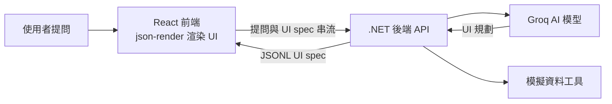
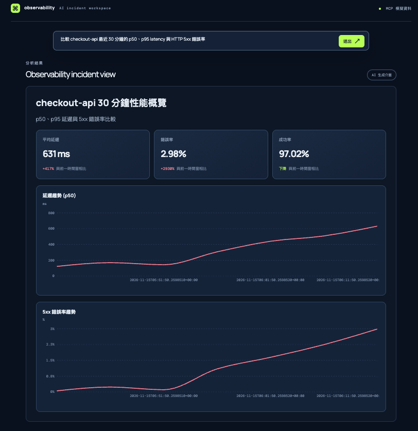
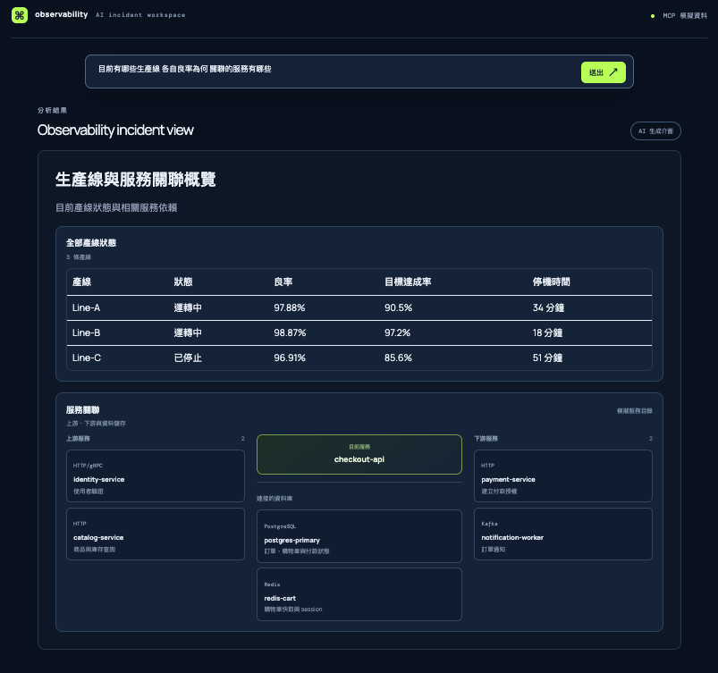

# Generative UI 可行性實驗

這個專案用來測試 **Generative UI 的可行性**：使用者以自然語言提問，AI 根據資料挑選合適的 UI 區塊，前端再把受控的 UI spec 渲染成圖表、表格和摘要。

目前實驗重點是把「資料查詢」和「畫面生成」拆開：後端負責意圖分類、呼叫資料函式、限制可用 widget，並驗證生成結果；AI 不會產生或執行任意前端程式碼。

## 技術分工

| 區域 | 技術 | 負責內容 |
| --- | --- | --- |
| 前端 | React、Vite、`@json-render/react`、`@json-render/shadcn`、Recharts | 提問、串流接收 JSONL patches、渲染 catalog 中註冊的元件 |
| 後端 | ASP.NET Core 10 MVC controllers（`ControllerBase`） | 意圖分類、執行 C# 資料函式、編譯與驗證 UI spec、串流 patches |
| 模型 | Groq Structured Outputs | 輸出固定 schema 的 intent 與簡化 `uiPlan` |
| 跨語言 UI 契約 | `backend/Catalog/catalog-contract.json` | 將前端 catalog 名稱、描述、範例與 JSON Schema 匯出給 .NET |
| 展示資料 | C# mock functions | 模擬 Grafana 監控、生產線和服務依賴查詢 |

## 系統架構



目前資料函式由後端程式依意圖明確選擇並呼叫，**不是 MCP，也不是讓模型自由挑選任意 function**。這讓實驗能分別觀察意圖分類、資料選擇和 UI 規劃是否可靠。之後可把 mock functions 換成 Grafana、Kubernetes、MES 或服務目錄的 API/MCP adapter。

## 展示與驗證情境

| 情境 | 範例提問 | 預期查詢工具 | 預期 UI 結果 |
| --- | --- | --- | --- |
| 監控異常調查 | 「checkout-api 最近 30 分鐘有沒有異常？顯示延遲、錯誤日誌和慢 trace」 | `query_monitoring_data` | KPI、延遲/錯誤率圖、LogTable、TraceWaterfall、IncidentReport |
| 全部產線狀態 | 「現在有哪些生產線？各自良率如何？哪些停線中？」 | `query_production_lines` | ProductionLineTable，列出狀態、良率、達標率和停機時間 |
| 單條產線詳情 | 「Line-A 這班生產狀況如何？顯示產量、工站與告警」 | `query_production_data` | ProductionOverview、產量圖、工站表和告警清單 |
| 服務依賴調查 | 「checkout-api 用了哪些資料庫？上游和下游服務有哪些？」 | `query_service_relationships` | ServiceDependencyGraph，呈現資料庫與服務關聯 |
| 跨領域調查 | 「組裝線現在的狀況如何？生產情形跟服務狀態如何？」 | `query_production_data` 或 `query_production_lines`，以及 `query_service_relationships`；若問題包含觀測指標也會查 `query_monitoring_data` | 依回傳資料組合產線、服務依賴或監控 widgets |

這些是手動展示／驗證情境，不代表每次生成的標題、區塊順序都固定。mock 數據每次會有變化；應確認選到的資料領域和 widget 正確、數據有畫出來、UI 沒有引用不存在的元件或 state path。

## 後端工具類型

| 工具函式 | 類型 | 何時呼叫 | 主要回傳資料 |
| --- | --- | --- | --- |
| `query_monitoring_data(service, timeRange)` | 監控資料查詢 | 延遲、錯誤率、SLO、logs、traces 或事故分析 | metrics、時間序列、traces、logs |
| `query_production_data(line, timeRange)` | 單條產線查詢 | 指定產線的產量、良率、工站、稼動率或設備告警 | summary、hourlyOutput、stations、alerts |
| `query_production_lines(timeRange)` | 多條產線查詢 | 比較所有產線、查良率或找停線產線 | 每條線的狀態、良率、達標率、產量和停機時間 |
| `query_service_relationships(service)` | 服務關聯查詢 | 查資料庫、上下游服務或故障影響範圍 | databases、upstream、downstream |

工具名稱對應後端 `MockDataTools` 的方法；目前沒有獨立的 HTTP route。`/api/generate` 會把適用的工具結果放進 `state`，AI 再根據 state 和本次可用元件規劃畫面。

## 安裝與啟動

需求：Node.js 22+、npm、.NET 10 SDK，以及 Groq API key。

在根目錄建立 `.env` 並填入 Groq key：

```sh
cp .env.example .env
```

### 安裝前端依賴與匯出 catalog

```sh
cd frontend
npm install
npm run export:catalog
```

catalog 匯出檔寫到 `backend/Catalog/catalog-contract.json`。修改 `frontend/src/catalog.js` 後需重新匯出並提交產物。

### 啟動前後端

開兩個終端機。

終端機 A，啟動後端：

```sh
cd backend
set -a
source ../.env
set +a
dotnet run
```

終端機 B，啟動前端：

```sh
cd frontend
npm run dev
```

預設前端使用 Vite 將 `/api` 轉送到 `http://127.0.0.1:3002`。在根目錄 `.env` 設定 `VITE_API_PROXY_TARGET` 可更換後端位址。

## 生成結果展示

### 範例一：監控資料與 UI 組裝

這個情境由後端的模擬監控工具產生延遲、錯誤率等假資料，目前是直接呼叫 C# mock function，尚未連接外部監控 API。流程會先依提問判斷資料領域與需要呈現的 widget，再由後端選用對應的查詢工具；取得資料後，AI 根據資料和可用元件規劃畫面，最後由前端渲染指標卡與趨勢圖。未來可將模擬資料來源替換成 Grafana MCP 或 Kubernetes API 等 adapter。



### 範例二：產線資料與服務拓樸

這個跨領域情境同時模擬工廠產線查詢，以及服務與其上下游服務、基礎設施和資料庫的關聯資料。系統依提問判斷要查詢的資料領域，後端呼叫產線與服務關聯工具，再依資料和可用元件規劃 UI，呈現產線狀態表及服務關聯拓樸，協助理解服務邊界與依賴關係。實際部署時，可將 mock functions 替換成產線系統、服務目錄或基礎設施 API／MCP 的資料介接。



## 各專案文件與 Demo 素材

- [Frontend README](frontend/README.md)：React、json-render、catalog、widgets、啟動與建置方式。
- [Backend README](backend/README.md)：controllers、API request/response 範例、mock data shape、流程與啟動方式。
- [Demo 素材資料夾](docs/demo-media/README.md)：放置快速展示用截圖與錄製影片。
